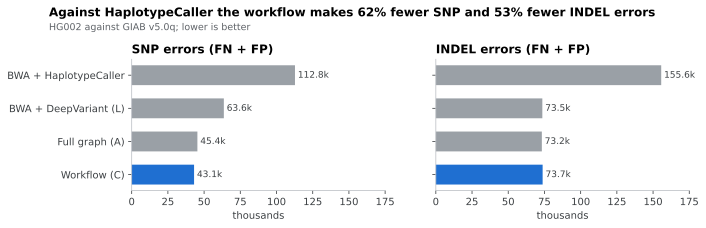
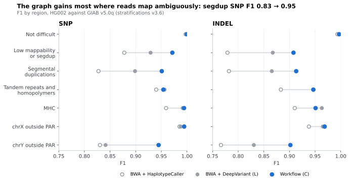
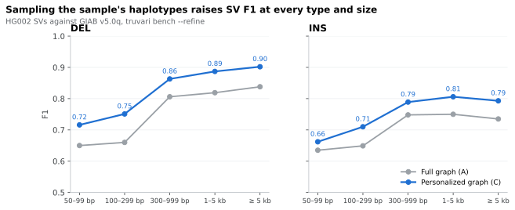
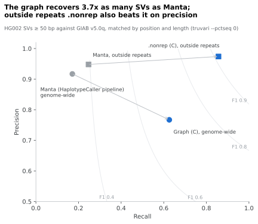

# HG002 benchmark

This page reports how accurately the germline workflow calls small variants and
structural variants (SVs) on HG002 (GIAB NA24385), and how that compares with a
linear-reference pipeline. HG002 is not among the samples used to build either
graph tested here, so it is an unbiased test sample.

**Summary**

- The workflow's default setup (C: a personalized JaSaPaGe graph with standard
  DeepVariant) was the most accurate setup tested: SNP F1 0.9978 and INDEL F1
  0.9963 on GIAB v4.2.1, and 0.9941 / 0.9583 on v5.0q.
- Against a conventional BWA + GATK HaplotypeCaller pipeline, it cut the v5.0q
  errors (FN + FP) by 62% for SNPs and 53% for INDELs. The largest gains were in
  segmental duplications, low-mappability regions, the MHC and chrY.
- SV F1 was 0.741 genome-wide. Most errors are SVs of 50 bp or more inside
  tandem repeats. Outside tandem repeats and homopolymers, the `.nonrep` output
  reached precision 0.979 and recall 0.862.
- The 738-haplotype combined graph (C') matched C on small variants and on SVs
  outside repeats, but was worse on SVs inside tandem repeats.

## Setups

All runs used the same reads: HG002 Illumina NovaSeq PCR-free at 35x, from
the DeepVariant case-study data (`HG002.novaseq.pcr-free.35x.dedup.grch38_no_alt.bam`,
about 835 million reads, one read group). The BAM was decoded back to FASTQ and
re-mapped.

| Setup | Mapping reference | Small variants | SVs |
| --- | --- | --- | --- |
| **C** (workflow default) | JaSaPaGe_GRCh38, personalized (2 sampled haplotypes + GRCh38) | DeepVariant 1.10.0 | `vg call` |
| C' | combined graph (738 haplotypes), personalized | DeepVariant 1.10.0 | `vg call` |
| A | JaSaPaGe_GRCh38, full graph (40 haplotypes) | DeepVariant 1.10.0 | `vg call` |
| B, D | as A, C | Pangenome-aware DeepVariant 1.10.0 | `vg call` |
| L | GRCh38 no_alt (BWA-MEM) | DeepVariant 1.10.0 | delly, Manta |
| HC | GRCh38 with ALT and decoy (BWA) | GATK HaplotypeCaller | Manta |

- **Mapping:** `vg giraffe` (vg 1.70.0), surjected onto GRCh38.
- **Personalized graphs:** sampled with `vg haplotypes --diploid-sampling` from
  the sample's k-mers (KMC, k = 29).
- **Small variants:** DeepVariant (WGS model) on the autosomes, PAR, chrX and
  chrY, with chrX and chrY haploid outside PAR.
- **SVs:** `vg call` on the whole graph.

## Small variants

**GIAB v4.2.1 (chr1–22)**

| Setup | SNP recall | SNP precision | SNP F1 | INDEL recall | INDEL precision | INDEL F1 |
| --- | --- | --- | --- | --- | --- | --- |
| **C** | 0.9976 | 0.9979 | **0.9978** | 0.9956 | 0.9970 | **0.9963** |
| C' | 0.9974 | 0.9979 | 0.9977 | 0.9954 | 0.9969 | 0.9961 |
| A | 0.9974 | 0.9974 | 0.9974 | 0.9953 | 0.9966 | 0.9960 |
| L | 0.9940 | 0.9989 | 0.9964 | 0.9936 | 0.9980 | 0.9958 |
| HC | 0.9913 | 0.9913 | 0.9913 | 0.9821 | 0.9864 | 0.9842 |
| Published (DeepVariant vg case study, HG003, HPRC v1.1) | 0.9973 | 0.9984 | 0.9979 | 0.9961 | 0.9976 | 0.9969 |

**GIAB v5.0q (includes chrX and chrY)**

| Setup | SNP recall | SNP precision | SNP F1 | INDEL recall | INDEL precision | INDEL F1 |
| --- | --- | --- | --- | --- | --- | --- |
| **C** | 0.9931 | 0.9951 | **0.9941** | 0.9537 | 0.9629 | **0.9583** |
| C' | 0.9923 | 0.9948 | 0.9936 | 0.9531 | 0.9630 | 0.9580 |
| A | 0.9926 | 0.9949 | 0.9938 | 0.9547 | 0.9626 | 0.9586 |
| L | 0.9870 | 0.9955 | 0.9912 | 0.9478 | 0.9682 | 0.9579 |
| HC | 0.9826 | 0.9863 | 0.9845 | 0.8811 | 0.9376 | 0.9085 |

v5.0q covers more difficult sequence than v4.2.1, so its INDEL values are lower.
More than 97% of the INDEL errors lie in tandem repeats and homopolymers.

**F1 by region (v5.0q, GIAB stratifications v3.6)**

| Region | SNP: HC | SNP: L | SNP: C | INDEL: HC | INDEL: L | INDEL: C |
| --- | --- | --- | --- | --- | --- | --- |
| Not difficult | 0.9975 | 0.9995 | 0.9996 | 0.9935 | 0.9968 | 0.9969 |
| Low mappability or segdup | 0.8778 | 0.9291 | 0.9715 | 0.7790 | 0.8674 | 0.9078 |
| Segmental duplications | 0.8274 | 0.8987 | 0.9509 | 0.7819 | 0.8655 | 0.9131 |
| Tandem repeats and homopolymers | 0.9401 | 0.9564 | 0.9539 | 0.8832 | 0.9471 | 0.9465 |
| MHC | 0.9593 | 0.9917 | 0.9944 | 0.9103 | 0.9632 | 0.9509 |
| chrX outside PAR | 0.9856 | 0.9880 | 0.9946 | 0.9379 | 0.9651 | 0.9686 |
| chrY outside PAR | 0.8303 | 0.8413 | 0.9447 | 0.7664 | 0.8305 | 0.9018 |

The gains come in two steps:
1. HaplotypeCaller → DeepVariant (HC → L) helps everywhere, including the regions
   that are not difficult.
2. Linear reference → personalized graph (L → C) helps mainly in low-mappability
   regions, segmental duplications and chrY.

**Pangenome-aware DeepVariant.** On the full graph (B) it doubled the SNP false
positives in segmental duplications. On the personalized graph (D) it raised the
SNP false negatives 3.8-fold, with MHC SNP recall falling from 0.995 to 0.874.
The workflow therefore defaults to standard DeepVariant.

## Structural variants

SVs of 50 bp or more, compared with truvari 5.5.0 `bench --refine` against
GIAB v5.0q. The truth set holds 28,123 SVs after splitting multi-allelic records.
84% of them lie in tandem repeats.

| Scope | Setup | Recall | Precision | F1 | FN | FP |
| --- | --- | --- | --- | --- | --- | --- |
| Genome-wide | **C** | 0.671 | 0.828 | **0.741** | 9,261 | 3,765 |
| Genome-wide | C' | 0.625 | 0.749 | 0.681 | 10,557 | 5,912 |
| Genome-wide | A | 0.627 | 0.736 | 0.677 | 10,483 | 6,134 |
| Not difficult | C | 0.921 | 0.987 | 0.953 | 472 | 73 |
| Not difficult | C' | 0.930 | 0.970 | 0.950 | 415 | 175 |
| `.nonrep` output | C | 0.862 | 0.979 | 0.917 | 635 | 83 |
| `.nonrep` output | C' | 0.870 | 0.964 | 0.914 | 602 | 146 |

- **`.nonrep`** is the workflow's output of simple DEL/INS calls outside tandem
  repeats and homopolymers: QUAL ≥ 30, a shorter allele of at most 10 bp, and no
  overlap with GIAB `GRCh38_AllTandemRepeatsandHomopolymers_slop5.bed.gz`. It is
  evaluated on the v5.0q benchmark regions minus that BED, which hold about 16%
  of HG002's SVs.
- **Personalized vs full graph:** the personalized graph (C) cut the false
  positives of the full graph (A) from 6,134 to 3,765, and raised recall and
  precision for every SV type and size.
- **SV size:** precision rises with SV size. With C it reaches 0.970 for
  deletions of 5 kb or more and 0.963 for insertions of that size.
- **Insertions:** recall for insertions stays at 0.60–0.71. Short reads cannot
  call an insertion that the graph does not contain.

**By SV type and size (genome-wide, v5.0q)**

| Type | Size | Truth SVs | A: recall | A: precision | A: F1 | C: recall | C: precision | C: F1 |
| --- | --- | --- | --- | --- | --- | --- | --- | --- |
| DEL | 50–99 bp | 4,200 | 0.659 | 0.642 | 0.650 | 0.669 | 0.771 | 0.716 |
| DEL | 100–299 bp | 3,056 | 0.665 | 0.655 | 0.660 | 0.704 | 0.806 | 0.751 |
| DEL | 300–999 bp | 2,085 | 0.791 | 0.822 | 0.806 | 0.818 | 0.913 | 0.863 |
| DEL | 1–5 kb | 611 | 0.802 | 0.837 | 0.819 | 0.845 | 0.934 | 0.887 |
| DEL | ≥ 5 kb | 191 | 0.775 | 0.913 | 0.838 | 0.843 | 0.970 | 0.902 |
| INS | 50–99 bp | 5,167 | 0.573 | 0.711 | 0.635 | 0.595 | 0.745 | 0.662 |
| INS | 100–299 bp | 5,706 | 0.546 | 0.800 | 0.649 | 0.616 | 0.839 | 0.710 |
| INS | 300–999 bp | 4,921 | 0.630 | 0.920 | 0.748 | 0.689 | 0.922 | 0.789 |
| INS | 1–5 kb | 1,848 | 0.633 | 0.921 | 0.750 | 0.710 | 0.933 | 0.806 |
| INS | ≥ 5 kb | 338 | 0.601 | 0.948 | 0.735 | 0.675 | 0.963 | 0.793 |

### SVs in tandem repeats

Against the GIAB Tandem Repeat benchmark v1.0.1, variants of 50 bp or more
inside tandem repeats reached an F1 of only 0.57–0.66 in every setup. This is
why the workflow leaves VNTRs out of its scope and adds the `.nonrep` output.

| Setup | 5–49 bp: recall | 5–49 bp: precision | 5–49 bp: F1 | ≥ 50 bp: recall | ≥ 50 bp: precision | ≥ 50 bp: F1 |
| --- | --- | --- | --- | --- | --- | --- |
| **C** | 0.856 | 0.934 | 0.893 | 0.643 | 0.686 | **0.664** |
| A | 0.854 | 0.935 | 0.892 | 0.609 | 0.601 | 0.605 |
| C' | 0.853 | 0.931 | 0.890 | 0.567 | 0.576 | 0.571 |
| L (DeepVariant only) | 0.829 | 0.945 | 0.883 | 0.011 | — | — |

- **C' compared with C:** for repeat variants of 50 bp or more, recall fell from
  0.607 to 0.506 for STRs and from 0.633 to 0.554 for VNTRs.
- **Why that might be:** a graph with many haplotypes holds many alleles of
  different lengths at a repeat. On chr21 the combined graph has 471 VNTR loci,
  with a median of 10 distinct lengths per locus and up to 622. Whether sampling
  keeps the right alleles at such loci was not settled.
- **KAGE 2:** genotyping the repeat SVs with KAGE 2 instead (a chr21 pilot with
  a 51,246-variant repeat panel) lowered the F1 for repeat SVs of 50 bp or more
  from 0.615 to 0.343.

### Comparison with a linear-reference pipeline

All callers here are compared under the same rule, which matches calls by
position and length only (`--pctseq 0 --dup-to-ins`), because Manta and delly
do not report full inserted sequences. The values therefore differ from the
refine results above.

| Scope | Method | Recall | Precision | F1 |
| --- | --- | --- | --- | --- |
| Genome-wide | Manta (HC pipeline) | 0.171 | 0.917 | 0.288 |
| Genome-wide | Manta (L BAM) | — | — | 0.346 |
| Genome-wide | delly (L BAM) | — | — | 0.205 |
| Genome-wide | **Graph (C)** | 0.626 | 0.767 | **0.689** |
| Outside repeats | Manta (HC pipeline) | 0.247 | 0.948 | 0.392 |
| Outside repeats | **`.nonrep` (C)** | 0.857 | 0.974 | **0.912** |
| Outside repeats | `.nonrep` (C') | 0.865 | 0.959 | 0.910 |

Manta is precise but finds only 17% of HG002's SVs. The graph recovers 3.7 times
as many genome-wide. Outside repeats, the `.nonrep` output beats Manta on
precision as well as recall.

## The combined graph and the number of candidates

The combined graph (738 haplotypes) is used through a personalized graph:
mapping to the full combined graph is more than ten times slower than mapping
to JaSaPaGe. Raising the candidates that diploid sampling picks from
(`num_haplotypes`) changed nothing measurable:

| Candidates | `vg haplotypes` time | SV recall | SV precision | SV F1 |
| --- | --- | --- | --- | --- |
| 32 (vg default) | 24 min | 0.573 | 0.664 | 0.615 |
| 128 | 75 min | 0.573 | 0.664 | 0.615 |
| 256 | 107 min | 0.573 | 0.664 | 0.615 |

The SV values in this table are truvari bench results before refine. The three
personalized graphs differed by less than 0.01% in size. The workflow's
default graph remains JaSaPaGe (setup C).

## Run time

Measured on one 128-core AMD EPYC node per stage, with the whole genome:

| Setup | FASTQ decoding | Mapping | Calling |
| --- | --- | --- | --- |
| A | 0:32 | 1:37 | 5:42 |
| C | (shared with A) | 1:22 | 5:19 |

Sampling and indexing the personalized JaSaPaGe graph took 41 min on 128 cores.
On the Slurm path, lanes map in parallel across nodes. With
`--variant parabricks`, the calling stage moves DeepVariant to GPUs.

## How the evaluation was done

The figures are drawn from the tables above by `docs/figures/make_figures.py`.

| Item | Detail |
| --- | --- |
| Small-variant truth | GIAB v4.2.1 (chr1–22, `noinconsistent` regions) and v5.0q `smvar` (all chromosomes, `diploidXY` truth) |
| SV truth | GIAB v5.0q `stvar`; GIAB Tandem Repeat benchmark v1.0.1 |
| Strata | GIAB genome stratifications v3.6 (GRCh38) |
| Small-variant tool | hap.py v0.3.12, `--convert-gvcf-query --pass-only`, with `--stratification` |
| SV tool | truvari 5.5.0 `bench --refine --pick ac --passonly -r 2000 -C 5000`, after `bcftools norm -m -any` and with `SVLEN` / `SVTYPE` / `SVSIM` removed; position-and-length rule `--pctseq 0 --dup-to-ins` |
| Repeat SVs | `truvari bench --sizemin 5 --pick ac`, then `truvari refine --use-original-vcfs` |

**Caveats**

- **hap.py and haploid genotypes:** hap.py v0.3.12 mis-scores haploid
  genotypes (`1`). For v5.0q the query's chrX and chrY calls were rewritten as
  `1/1` and compared with the `diploidXY` truth. v4.2.1 covers chr1–22 only, so
  it is unaffected.
- **The HaplotypeCaller VCF was unfiltered** (all FILTER `.`). VQSR or hard
  filtering would raise its precision, so this comparison is unfavourable to HC.
- **HC was aligned to a different reference** (GRCh38 with ALT and decoy
  contigs, against no_alt for L). All setups were evaluated on the primary
  chromosomes.
- **Published values** are from HG003 with the HPRC v1.1 graph, so they are a
  reference point, not a like-for-like comparison.
